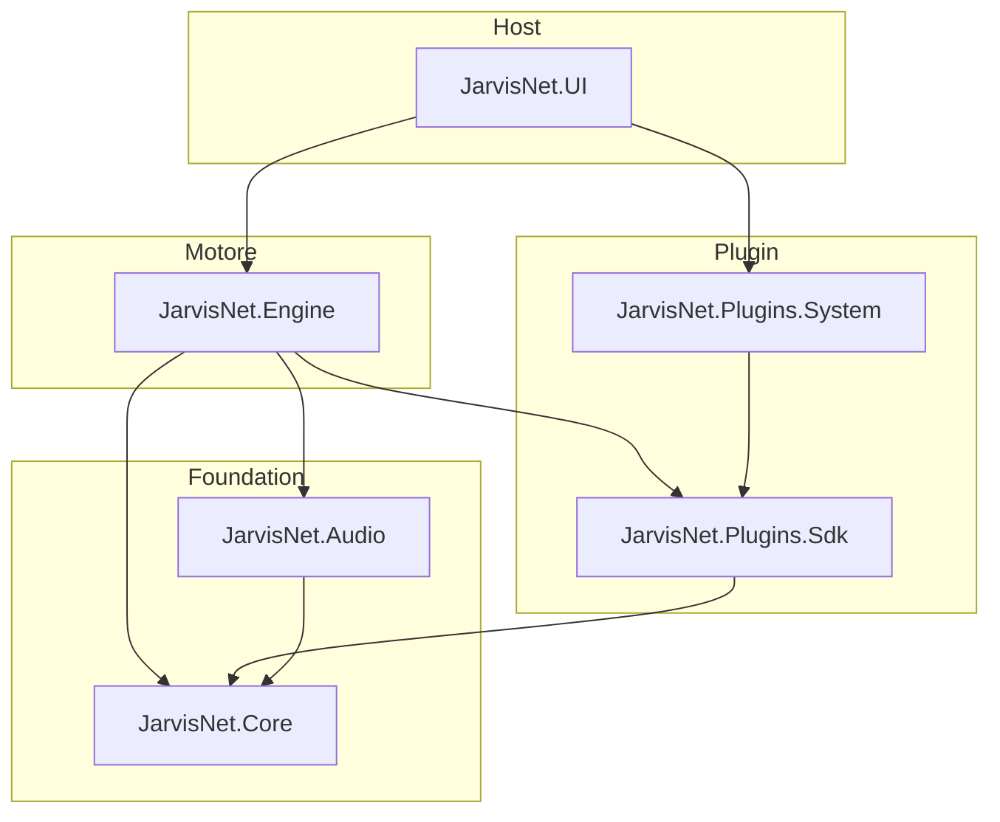

# JarvisNet

Assistente personale in stile «Jarvis», sviluppato in **.NET 10**. L’obiettivo è combinare un motore conversazionale basato su **Semantic Kernel** e modelli locali (**Ollama**), input/output **audio** (cattura e sintesi vocale) e un sistema di **plugin** estendibile, esposto tramite un host web ASP.NET Core.

> **Stato attuale:** la solution definisce i moduli e le dipendenze principali; gran parte della logica di dominio è ancora da implementare. L’host principale è `JarvisNet.UI`.

## Architettura



| Progetto | Ruolo |
|----------|--------|
| **JarvisNet.Core** | Tipi condivisi, contratti e logica di base. |
| **JarvisNet.Engine** | Orchestrazione dell’assistente (Semantic Kernel, connettore Ollama). |
| **JarvisNet.Audio** | Audio in/out (NAudio WASAPI/ALSA, STT Sherpa-ONNX, TTS PiperSharp). |
| **JarvisNet.Plugins.Sdk** | API per scrivere plugin compatibili con il motore. |
| **JarvisNet.Plugins.System** | Plugin di sistema forniti out-of-the-box. |
| **JarvisNet.UI** | API web (Minimal API) — punto di ingresso consigliato per eseguire l’applicazione. |
| **JarvisNet.Telegram** | Bot Telegram (polling): chat testuale e messaggi vocali verso lo stesso motore della UI. |
| **JarvisNet.UI.Server** | Progetto web aggiuntivo in solution (scaffold separato). |

### Test

| Progetto | Framework | Riferimento |
|----------|-----------|-------------|
| **JarvisNet.UnitTests** | NUnit | `JarvisNet.Engine` |
| **JarvisNet.IntegrationTests** | NUnit | `JarvisNet.UI` |
| **JarvisNet.Audio.UnitTests** | NUnit | `JarvisNet.Audio` |
| **JarvisNet.Audio.IntegrationTests** | NUnit | `JarvisNet.Audio` |
| **JarvisNet.Audio.TestApp** | Console | test interattivo microfono/STT/TTS |
| **JarvisNet.Engine.UnitTests** | NUnit | `JarvisNet.Engine` |
| **JarvisNet.Engine.IntegrationTests** | NUnit | `JarvisNet.Engine` (Ollama locale) |
| **JarvisNet.Engine.TestApp** | Console | conversazione vocale STT → Ollama → TTS |

## Prerequisiti

- [.NET 10 SDK](https://dotnet.microsoft.com/download)
- Per il motore LLM locale: [Ollama](https://ollama.com/) con modello **`jarvis:1b-new`** (tag in `/api/tags`; es. `ollama pull jarvis:1b-new`)
- Stack audio: **Windows** (WASAPI) e **Linux** (`libasound2`); modelli in `models/` e Piper in `piper/` alla root del repo

## Quick start

Dalla root del repository:

```powershell
dotnet restore JarvisNet.slnx
dotnet build JarvisNet.slnx
dotnet run --project src/JarvisNet.UI/JarvisNet.UI.csproj
```

In sviluppo, l’API espone OpenAPI su `/openapi/v1.json` (profilo predefinito in `launchSettings.json`: HTTP `5194`, HTTPS `7077`).

Eseguire i test:

```powershell
dotnet test JarvisNet.slnx
```

Modelli ONNX e Piper condivisi (root repo, usati da TestApp e host reali):

```powershell
powershell -ExecutionPolicy Bypass -File scripts/Download-Models.ps1
powershell -ExecutionPolicy Bypass -File scripts/Download-Models.ps1 -Locale es
powershell -ExecutionPolicy Bypass -File scripts/Download-Models.ps1 -Locale en
powershell -ExecutionPolicy Bypass -File scripts/Download-Piper.ps1
```

Config condivise (caricate con `AddJarvisNetSharedAudioConfiguration` / `AddJarvisNetSharedEngineConfiguration`):

| Area | File |
|------|------|
| Engine (Ollama) | [`config/jarvisnet.engine.json`](config/jarvisnet.engine.json) |
| MCP (stdio) | [`config/jarvisnet.mcp.json`](config/jarvisnet.mcp.json) |
| Telegram | [`config/jarvisnet.telegram.json`](config/jarvisnet.telegram.json) + [`config/jarvisnet.telegram.secrets.json`](config/jarvisnet.telegram.secrets.json) (locale, gitignored) |

Il plugin **SearchWeb** (`search_internet`) interroga **Wikipedia** (API REST, lingua da `JarvisNet:Locale:CultureName`, es. `it-IT` → `it.wikipedia.org`). Non serve alcuna API key.

Config audio condivisa:

| Profilo | File |
|---------|------|
| Italiano (default) | [`config/jarvisnet.audio.json`](config/jarvisnet.audio.json) |
| Spagnolo (Spagna) | [`config/jarvisnet.audio.es.json`](config/jarvisnet.audio.es.json) |

Per il TestApp in spagnolo: `$env:JARVISNET_AUDIO_PROFILE="es"` prima di `dotnet run`, oppure passa il profilo a `AddJarvisNetSharedAudioConfiguration(..., profile: "es")`.

Voce TTS (`JarvisNet:Audio:PiperVoiceKey`):

| Chiave | Lingua | Voce |
|--------|--------|------|
| `it_IT-paola-medium` | IT | donna (default) |
| `it_IT-serena-high` | IT | donna, alta qualità |
| `it_IT-leonardo-medium` | IT | uomo (kirys79) |
| `it_IT-giorgio-medium` | IT | uomo (kirys79) |
| `es_ES-sharvard-medium` | ES (Spagna) | donna (speaker 1, consigliata) |
| `es_ES-mls_10246-low` | ES | donna (bassa qualità) |
| `es_AR-daniela-high` | ES (Argentina) | donna, alta qualità |
| `es_ES-carlfm-x_low` | ES | uomo |
| `en_US-ljspeech-high` | EN (US) | donna, alta qualità |
| `en_US-ryan-high` | EN (US) | uomo, alta qualità |

Test vocale interattivo (solo audio):

```powershell
dotnet run --project tests/JarvisNet.Audio.TestApp/JarvisNet.Audio.TestApp.csproj
$env:JARVISNET_AUDIO_PROFILE="es"; dotnet run --project tests/JarvisNet.Audio.TestApp/JarvisNet.Audio.TestApp.csproj
```

Conversazione vocale end-to-end (STT → Ollama → TTS):

```powershell
dotnet run --project tests/JarvisNet.Engine.TestApp/JarvisNet.Engine.TestApp.csproj
```

Il motore usa **Microsoft Semantic Kernel** con connettore **Ollama** (pacchetto alpha, warning sperimentale `SKEXP0070` soppresso nel codice di registrazione).

## MCP Slack e altri server

JarvisNet avvia server [Model Context Protocol](https://modelcontextprotocol.io) in processo (`npx` + stdio) e registra i tool nel kernel Semantic Kernel. La definizione è in [`config/jarvisnet.mcp.json`](config/jarvisnet.mcp.json); i **segreti** vanno in file locali **non committati** (vedi `.gitignore`):

| File | Uso |
|------|-----|
| [`config/jarvisnet.mcp.secrets.json`](config/jarvisnet.mcp.secrets.json) | Token e override (caricato automaticamente) |
| [`config/jarvisnet.mcp.secrets.env`](config/jarvisnet.mcp.secrets.env) | Opzionale: stesse chiavi in formato `McpServers__Slack__Env__…` (righe vuote ignorate) |

Prerequisito: **Node.js 20+** e `npx` in PATH (come per Playwright).

All’avvio, nei log cerca ad es. `Server MCP Slack: registrati N tool`. In UI, Slack compare nell’orbita moduli solo se l’MCP parte correttamente.

### Aggiungere Slack (user token `xoxp`)

Usiamo [`slack-mcp-server`](https://github.com/korotovsky/slack-mcp-server) con **User OAuth Token**: agisce come il tuo utente sui canali a cui hai già accesso (es. `#idee`), senza invitare un bot nel canale.

1. **Slack App** — [api.slack.com/apps](https://api.slack.com/apps) → **Create New App** → **Blank app** → workspace corretto.
2. **OAuth & Permissions** → **User Token Scopes** (non Bot Token Scopes), minimo consigliato:
   - `channels:history`, `channels:read`, `users:read`
   - per l’avvio del server MCP servono anche: `groups:read`, `groups:history`, `mpim:read`, `im:read`
   - opzionale: `search:read` (ricerca messaggi)
3. **Install to Workspace** → copia **User OAuth Token** (`xoxp-…`). Dopo ogni modifica agli scope, reinstalla e aggiorna il token.
4. **Config repo** — in [`config/jarvisnet.mcp.json`](config/jarvisnet.mcp.json) la voce `Slack` è già presente (disabilitata di default). Abilita e metti il token in [`config/jarvisnet.mcp.secrets.json`](config/jarvisnet.mcp.secrets.json):

```json
{
  "McpServers": {
    "Slack": {
      "Enabled": true,
      "Env": {
        "SLACK_MCP_XOXP_TOKEN": "xoxp-…"
      }
    }
  }
}
```

5. **Riavvia** l’host (`dotnet run --project src/JarvisNet.UI/JarvisNet.UI.csproj`).

Esempi in chat: *«Leggi gli ultimi messaggi su #idee»* (tool `conversations_history`, `channel_id`: `#idee`). La lettura è **on demand**; non c’è push automatico su ogni messaggio Slack.

> **Nota:** non mettere il token in `jarvisnet.mcp.json` (file committato). Evita righe vuote tipo `SLACK_MCP_XOXP_TOKEN=` in `.secrets.env`: sovrascrivono il valore nel JSON.

### Aggiungere Gmail (IMAP, senza Google Cloud)

Usiamo [`gmail-mcp-imap`](https://www.npmjs.com/package/gmail-mcp-imap): accesso via **IMAP** con **password per le app** — niente progetto Google Cloud, niente trial fatturazione.

1. **Gmail** → Impostazioni → **Inoltro e POP/IMAP** → abilita **IMAP**.
2. **Account Google** — [Sicurezza](https://myaccount.google.com/security):
   - attiva **Verifica in due passaggi**;
   - **Password per le app** (cerca “Password per le app”) → app **Mail** → copia la password di 16 caratteri (non la password Gmail normale).
3. **Secrets** in [`config/jarvisnet.mcp.secrets.json`](config/jarvisnet.mcp.secrets.json):

```json
{
  "McpServers": {
    "Gmail": {
      "Enabled": true,
      "Env": {
        "GMAIL_EMAIL": "tuo@gmail.com",
        "GMAIL_APP_PASSWORD": "xxxx xxxx xxxx xxxx"
      }
    }
  }
}
```

4. **Riavvia** l’host. Nei log: `Server MCP Gmail: registrati N tool`.

Esempi in chat: *«Leggi le ultime mail in Primary»*, *«Cerca mail non lette di questa settimana»*. I tool espongono anche invio/modifica: chiedi esplicitamente solo **lettura** se non vuoi azioni di scrittura.

> **Nota:** su **Google Workspace** l’admin può disabilitare IMAP. In quel caso serve l’API OAuth (Google Cloud) o il [MCP ufficiale remoto](https://developers.google.com/workspace/gmail/api/guides/configure-mcp-server?hl=it). Revoca l’accesso eliminando la password per le app in qualsiasi momento.

### Altri MCP

Aggiungi una chiave in `McpServers` in `jarvisnet.mcp.json` (`Command`, `Args`, `Enabled`, `Env`). Playwright usa anche [`config/playwright-mcp.json`](config/playwright-mcp.json).

## Bot Telegram

Il modulo **JarvisNet.Telegram** parte insieme a `JarvisNet.UI` (hosted service in polling). Puoi scrivere in chat o inviare **messaggi vocali** (icona microfono): i vocali vengono trascritti con lo stesso STT Sherpa configurato in `jarvisnet.audio.json`, poi Jarvis risponde in **testo** con gli stessi plugin/MCP del motore. Ogni chat Telegram ha **cronologia separata** da quella vocale della UI.

Prerequisito: **Ollama** in esecuzione e modelli STT presenti (`scripts/Download-Models.ps1`).

### Creare il bot

1. Su Telegram apri [@BotFather](https://t.me/BotFather) → **/newbot** → segui i passaggi e copia il **token** (`123456789:ABC…`).
2. In repo, copia [`config/jarvisnet.telegram.secrets.json.example`](config/jarvisnet.telegram.secrets.json.example) in `config/jarvisnet.telegram.secrets.json` (non committato, vedi `.gitignore`) e inserisci token e chat id:

```json
{
  "JarvisNet": {
    "Telegram": {
      "Enabled": true,
      "BotToken": "123456789:ABCdefGHIjklMNOpqrsTUVwxyz",
      "AllowedChatIds": []
    }
  }
}
```

3. **Riavvia** l’host:

```powershell
dotnet run --project src/JarvisNet.UI/JarvisNet.UI.csproj
```

Nei log cerca: `Bot Telegram avviato: @nome_bot`. Se `Enabled` è `false` o manca il token: `Bot Telegram disabilitato`.

### Opzioni (`JarvisNet:Telegram`)

| Chiave | Descrizione |
|--------|-------------|
| `Enabled` | `true` per avviare il polling. |
| `BotToken` | Token da BotFather. Meglio solo in `jarvisnet.telegram.secrets.json`. |
| `AllowedChatIds` | Elenco numerico di chat id autorizzati. **Array vuoto** = accetta qualsiasi chat (utile per provare); poi restringi. |

Per scoprire il tuo **chat id**: scrivi `/start` o `/chatid` al bot. Se la chat non è in lista e `AllowedChatIds` non è vuoto, il bot risponde con il tuo id da aggiungere in config.

### Comandi bot

| Comando | Effetto |
|---------|---------|
| `/start` | Messaggio di benvenuto e riepilogo comandi. |
| `/reset`, `/nuova` | Azzera la cronologia **solo** di quella chat Telegram. |
| `/chatid` | Mostra l’id numerico della chat. |

Messaggi normali (testo o vocale) vengono elaborati come richieste a Jarvis (ricerca web, Gmail, Slack, Playwright, ecc., se configurati).

> **Nota:** non committare il token in `jarvisnet.telegram.json`. Le risposte Telegram sono solo testo (niente TTS in chat). I file musicali inviati come “Audio” non sono supportati: usa il **messaggio vocale** nativo di Telegram.

## Struttura repository

```
JarvisNet/
├── JarvisNet.slnx
├── config/                    ← jarvisnet.audio.json, jarvisnet.engine.json, jarvisnet.mcp.json, jarvisnet.telegram.json, *.secrets.*
├── scripts/                   ← Download-Models.ps1, Download-Piper.ps1
├── models/                    ← stt/, tts/ (gitignored, download script)
├── piper/                     ← runtime Piper (gitignored)
├── src/
│   ├── JarvisNet.Core/
│   ├── JarvisNet.Engine/
│   ├── JarvisNet.Audio/
│   ├── JarvisNet.Plugins.Sdk/
│   ├── JarvisNet.Plugins.System/
│   ├── JarvisNet.Telegram/
│   ├── JarvisNet.UI/          ← host principale
│   └── JarvisNet.UI.Server/
└── tests/
    ├── JarvisNet.UnitTests/
    ├── JarvisNet.Audio.UnitTests/
    ├── JarvisNet.Audio.IntegrationTests/
    ├── JarvisNet.Audio.TestApp/
    ├── JarvisNet.Engine.UnitTests/
    ├── JarvisNet.Engine.IntegrationTests/
    ├── JarvisNet.Engine.TestApp/
    └── JarvisNet.IntegrationTests/
```

## Stack tecnologico

- **ASP.NET Core** — host HTTP e OpenAPI
- **Microsoft Semantic Kernel** + **Ollama** — ragionamento e chat con modelli locali
- **NAudio** / **PiperSharp** — pipeline audio
- **NUnit** — test unitari e di integrazione

## Configurazione

Impostazioni di base in `src/JarvisNet.UI/appsettings.json` e `appsettings.Development.json`. Ollama è configurabile in [`config/jarvisnet.engine.json`](config/jarvisnet.engine.json) (`JarvisNet:Ollama`: `Endpoint`, `ModelName`, `SystemPrompt`, `Temperature`). MCP: sezione [MCP Slack e altri server](#mcp-slack-e-altri-server). Telegram: sezione [Bot Telegram](#bot-telegram). Evitare di committare segreti (`config/jarvisnet.mcp.secrets.*`, `config/jarvisnet.telegram.secrets.json`, vedi `.gitignore`).

## Licenza

Da definire.
